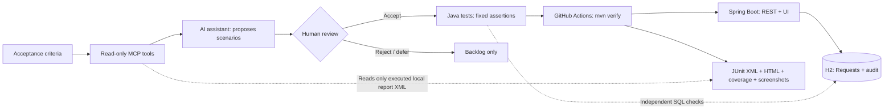

# AI-Assisted QA Automation: Travel Approval Controls

**Java 21 · Spring Boot · REST Assured · Playwright Java · H2/SQL · Docker · GitHub Actions · MCP · JUnit/JaCoCo**

Portfolio-grade demonstration of how an SDET can take a synthetic investment-banking-style travel-approval requirement from **business rule → AI-assisted scenario suggestions → engineering review → executable assertions → CI test results → published evidence**.

> **Verification status:** This repository contains runnable source, but no green CI result is claimed until the workflow executes successfully in your GitHub account. The sample `ai/candidate-scenarios.json` is an illustrative backlog, **not** an actual Copilot/model-generated transcript or validation result. AI can propose tests; engineers approve the assertions; a real test run produces evidence.


## What a hiring manager can inspect

| Concern | Concrete evidence in this repository |
|---|---|
| Requirement traceability | [Business acceptance criteria](docs/requirements.md) (BR-01 through BR-08) |
| AI/MCP integration | [Official SDK v2 stdio MCP server](mcp/server.mjs), [real client handshake smoke test](mcp/smoke-test.mjs), [Copilot MCP configuration](.vscode/mcp.json) |
| Human-in-the-loop design | [Candidate scenarios with accept/reject/defer decisions](ai/candidate-scenarios.json) and [drafting prompt](ai/ai-assistant-prompt.md) |
| REST API automation | [REST Assured tests](src/test/java/com/portfolio/travel/TravelRequestApiTest.java) |
| UI automation | [Playwright Chromium test](src/test/java/com/portfolio/travel/TravelApprovalUiTest.java) |
| Integrity and controls | SQL checks of request status and audit-event counts + access control, self-approval, terminal-state and duplicate processing tests |
| Build and deployment | [Dockerfile](Dockerfile), [Compose](compose.yaml), [GitHub Actions](.github/workflows/ci.yml) |
| Execution evidence | Generated JUnit XML, Maven Surefire HTML, JaCoCo coverage HTML, failure-only screenshots in Actions artifacts |
| Interview presentation | [3-minute screen-recording storyboard](docs/DEMO.md) |

## Architecture and workflow



The MCP server has **read-only** tools: `get_requirement`, `get_candidate_scenarios`, `get_api_and_test_contract`, `read_local_verification`. It supplies trusted repo context to an AI host (such as Copilot) and never writes source code or marks a test passed. The included MCP smoke test establishes a real stdio connection and calls registered tools; **it is not an LLM call**.

## Application feature

Alice requests a trip; Bob independently approves or rejects it. Only a pending request can be decided. Creation and decision append audit events. A caller's `Idempotency-Key` prevents duplicate sequential processing. REST responses and persisted H2 values are compared in tests. The sample application is intentionally small to make assertions and controls auditable.

| Demo login token | Username | Role |
|---|---|---|
| `demo-employee` | alice | EMPLOYEE |
| `demo-other-employee` | charlie | EMPLOYEE (privacy negative case) |
| `demo-approver` | bob | APPROVER |
| `demo-self-approver` | alice | APPROVER (self-approval negative case) |

**Security boundary:** These hard-coded **local demonstration credentials are not real security**. Production would require OIDC/JWT, signed claims, server-managed identity, least-privilege roles, secret management, HTTPS and a proper audit design. Do not deploy to an internet-facing system with demo tokens.

## Getting started

### Requirements

- Java 21 and Maven 3.9+
- Node.js 20+ for the MCP server and traceability script
- Chromium installed through Playwright for the browser test
- Docker Engine + Compose only for the optional container demonstration

### Run application locally

```bash
mvn spring-boot:run
```

Visit **http://localhost:8080**. Select Alice, submit a trip with future dates, select Bob, approve it and inspect Audit.

Run a **real HTTP mini-demo** from another terminal while the app is running:

```bash
node scripts/demo-api.mjs
```

This script only prints `API DEMONSTRATION PASSED` after it actually verifies a 201 creation, 403 self-approval denial, 200 independent approval, two audited events and idempotent replay.

### Run Java API and UI tests

On macOS/Linux, install the Chromium browser and dependencies (this is what CI does):

```bash
mvn -B -q dependency:build-classpath -Dmdep.includeScope=test -Dmdep.outputFile=/tmp/travel-qa-cp.txt
java -cp "$(cat /tmp/travel-qa-cp.txt)" com.microsoft.playwright.CLI install --with-deps chromium
mvn clean verify
```

On Windows/PowerShell with Java and Maven installed:

```powershell
mvn -q dependency:build-classpath -Dmdep.includeScope=test -Dmdep.outputFile=playwright-classpath.txt
$cp = (Get-Content playwright-classpath.txt -Raw).Trim()
java -cp $cp com.microsoft.playwright.CLI install chromium
mvn clean verify
```

The `@SpringBootTest(webEnvironment = RANDOM_PORT)` tests start a real application on an ephemeral port, so you do **not** need to run `mvn spring-boot:run` separately for tests. The CI runner installs Linux browser dependencies; on a workstation, install OS libraries as needed.

Report locations after successful `mvn verify`:

```text
target/surefire-reports/TEST-*.xml    # actual JUnit test status
target/site/surefire-report.html    # HTML test summary
target/site/jacoco/index.html       # code coverage
target/screenshots/ui-failure.png   # generated only when browser test fails
```

**Important:** Existence of code or an AI backlog is not test execution evidence. A passed result must come from actual JUnit/Surefire output in the current run.

### Run MCP server and protocol smoke test

```bash
npm --prefix mcp install
npm --prefix mcp run smoke
node scripts/check-review.mjs
```

Add/open this folder in VS Code with Copilot Chat and an MCP-capable client: [`.vscode/mcp.json`](.vscode/mcp.json) registers the local `travel-qa` server. Use the [suggestion prompt](ai/ai-assistant-prompt.md), inspect generated scenarios, manually decide which are acceptable, and only then ask for executable Java drafts. For IntelliJ, register the same stdio command (`node <absolute-repo-path>/mcp/server.mjs`) using your installed MCP-compatible IDE/plugin integration. Validate that Copilot discovers the four tools; tooling support varies by IDE/version.

The MCP server uses the official Model Context Protocol TypeScript v2 SDK. Its `read_local_verification` tool outputs `NO EXECUTION EVIDENCE` until genuine test XML exists.

### Docker demonstration

```bash
docker compose up --build -d
# app available at http://localhost:8080
docker compose down
```

Compose uses an H2 **file-based** database in a named volume so demo records survive application restart. The Maven tests use an **in-memory** H2 database to isolate checks. Do not treat an embedded database as a regulated production data platform.

### CI and report publishing

`.github/workflows/ci.yml` runs on pushes, PRs and manual dispatch. The Java job:

1. Sets up JDK 21 and Node 22.
2. Performs the static review/traceability check (explicitly **not** a passing test claim).
3. Installs MCP dependencies, establishes a real protocol connection and calls requirement/evidence tools.
4. Installs Playwright Chromium and required Linux libraries.
5. Executes `mvn clean verify` (REST Assured + Chromium Playwright + SQL data checks).
6. Uploads actual JUnit XML, Surefire HTML, JaCoCo and screenshots as an Actions **artifact**, even if tests fail.

A second CI job builds the deployable Docker image (without pushing to a registry). CI does **not** publish an unreviewed model-generated assertion and does **not** require an LLM API key.

## From model suggestion to assertion: two different statuses

| Stage | Example | Can claim the test passed? |
|---|---|---|
| AI draft | “Reject self-approval; no audit write” | **No** — only a candidate scenario |
| Human review | Approve BR-03 negative case, map to `blockEmployeeApprovalAndApproverSelfApprovalWithoutAuditMutation` | **No** — acceptable test design, not execution |
| Compiled Java test | Explicitly assert 403 + error code + exactly one unchanged audit record | **No** — code exists but is not yet run |
| CI execution | JUnit XML confirms executed test passed in a particular run | **Yes, for that run** — attach run URL and report |

The example backlog also includes a **rejected** idea that would override a rejected request and a **deferred** high-concurrency idempotency claim; neither becomes an assertion. Review mapping is statically checked by `scripts/check-review.mjs`. That script only validates structure and source-method references, not correctness.

## Quality limitations / production extension ideas

1. Implement real authentication/authorization with OIDC and signed tokens.
2. Add concurrency-safe idempotency semantics, transaction/locking tests, and durable production DB.
3. Add API contract/schema checks, access control matrix, security scanning, mutation testing and explicit coverage thresholds.
4. Add audit DB immutability controls, trace IDs, retention policies and sensitive-data redaction.
5. Capture the real Copilot generation session and provide a recorded demo; never fabricate screen captures or green CI results.

## Launch on GitHub

Create an empty GitHub repository (suggested name: `ai-assisted-compliance-test-automation`). From the folder root:

```bash
git init
git add .
git commit -m "Add AI-assisted travel approval QA portfolio project"
git branch -M main
git remote add origin https://github.com/YOUR_USERNAME/ai-assisted-compliance-test-automation.git
git push -u origin main
```

Replace `YOUR_USERNAME` and configure authentication. Open **Actions** and trigger the workflow. Add the *actual* run link, CI badge and screenshot to your README only after a successful run. In the hiring conversation, explain *the decisions behind the assertions*, not just the number of frameworks.

## Independent source links

- [Playwright Java CI](https://playwright.dev/java/docs/ci)
- [MCP TypeScript SDK v2 guide](https://github.com/modelcontextprotocol/typescript-sdk/blob/main/docs/get-started/first-server.md)
- [GitHub Actions Java/Maven build guide](https://docs.github.com/en/actions/tutorials/build-and-test-code/java-with-maven)

**License:** MIT for this original sample project. All example requirements, characters and requests are synthetic.
